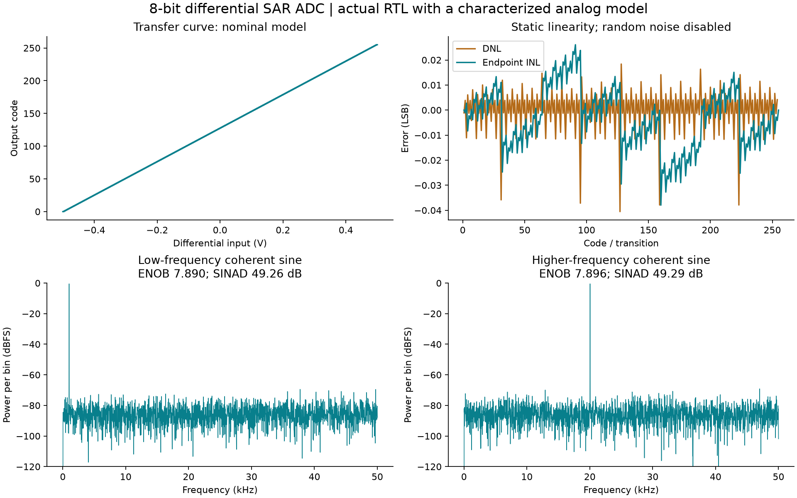

# 8-bit differential SAR ADC

A software-only mixed-signal design project by Abhitesh Shukla: synthesizable SAR RTL, paired charge-redistribution capacitor arrays, stateful analog models, online SKY130 SPICE characterization, and reproducible verification.

**[Engineering report](report/engineering-report.md)** · **[Phase results](docs/PHASE_RESULTS.md)** · **[Architecture](docs/architecture.md)** · **[Learning guide](docs/learning-guide.md)**



## What is implemented

- An independent direct quantizer and charge-derived SAR reference.
- A real SystemVerilog controller and an explicit one-hot alternative.
- Actual Icarus RTL connected cycle-by-cycle to a Python analog model.
- Acquisition, DAC settling, fixed unit-capacitor mismatch, offset/noise, leakage and an equivalent reference network.
- Online ngspice circuit measurements on GitHub-hosted Ubuntu, with source/model hashes and raw logs. A browser EEcircuit RC smoke test is also retained.
- A transistor-level SKY130 regenerative comparator and sampled-CDAC circuit benches; reduced-order calibration and held-out validation.
- Coherent actual-RTL dynamic records, static linearity measurements, and 1,000 seeded capacitor-mismatch sensitivity instances.
- SKY130 standard-cell synthesis and separately reported pre-layout timing.

## Results and scope

| Metric | Target | Measured simulation result |
|---|---|---|
| Resolution | 8 bits | All 256 codes observed |
| Sustained sample interval | 32 clocks | 32 clocks at 3.2 MHz: 100 kS/s |
| Max absolute DNL | <= 0.75 LSB | 0.04052 LSB |
| Max absolute endpoint INL | <= 1 LSB | 0.03794 LSB |
| Uncorrected ENOB, 1000.98 Hz | >= 7 | 7.890 bits |
| SINAD, low-frequency record | Report | 49.258 dB |
| Uncorrected ENOB, 20043.95 Hz | Report | 7.896 bits |


The ADC results above come from **actual RTL plus a reduced-order analog model**. Acquisition/DAC-driver RC and comparator delay are characterized against online SPICE. Capacitor mismatch, random noise, offset, leakage and reference-impedance parameters remain declared assumptions. Static linearity is measured with random noise disabled; FFT records include the declared noise model. These are not silicon measurements or foundry-qualified yield results.

The input differential span is -0.5 to +0.5 V at a 0.9 V common mode and nominal 1.8 V supply. The accepted-start to data-valid edge latency is 31 clock periods; continuous accepted starts are 32 periods apart. Each side of the CDAC uses 255 weighted unit capacitors plus a dummy.

## Phase-by-phase evidence

| Phase | Gate | Result | Details |
|---|---|---|---|
| 0 | Tools and online circuit smoke test | PASSED | [Evidence](results/phases/phase-00.json) |
| 1 | Specification, charge equations and timing contract | PASSED | [Evidence](results/phases/phase-01.json) |
| 2 | Independent reference and analysis validation | PASSED | [Evidence](results/phases/phase-02.json) |
| 3 | Real RTL controller verification | PASSED | [Evidence](results/phases/phase-03.json) |
| 4 | Behavioural analog model with actual RTL | PASSED | [Evidence](results/phases/phase-04.json) |
| 5 | Online circuit characterization | PASSED | [Evidence](results/phases/phase-05.json) |
| 6 | SPICE-derived model with actual RTL | PASSED | [Evidence](results/phases/phase-06.json) |
| 7 | Static, dynamic and sensitivity characterization | PASSED | [Evidence](results/phases/phase-07.json) |
| 8 | SKY130 synthesis and pre-layout static timing | PASSED | [Evidence](results/phases/phase-08.json) |
| 9 | Clean reproduction and release audit | PASSED | [Evidence](results/phases/phase-09.json) |

Failed GitHub workflow attempts remain in the Actions history. A workflow failure is not relabelled as an engineering pass; the saved individual phase checks and online artifacts show what actually ran.

## Digital implementation comparison

| FSM encoding | Mapped cells | Cell area (um^2) | Setup/hold worst-slack values (ns) |
|---|---:|---:|---|
| binary | 127 | 1277.475 | 155.608, 0.348 |
| one-hot | 138 | 1355.050 | 155.608, 0.280 |

Area is for the controller including its debug outputs, at SKY130 HD TT 25 C / 1.8 V. Analog blocks, clock tree, pads and physical routing are excluded. Timing is pre-layout with an ideal clock and explicit external comparator/interface delay assumptions; inspect the SDC and logs before interpreting slack.

## Run the project

Use Python 3.11+ with Icarus Verilog and Yosys installed. The timing stage also needs OpenSTA.

```bash
python -m venv .venv
# Activate the virtual environment for your OS.
python -m pip install -r requirements.txt
python -m pytest -q
python -m tools.verify_foundations
python -m tools.verify_rtl
python -m tools.verify_variants
python -m tools.verify_analog
python -m tools.characterize
python -m tools.synthesize
python -m tools.report
```

The verification bridge replaces the original plan's cocotb/VPI dependency with a portable line protocol. It observes and drives the actual simulated RTL; it does not emulate the RTL state machine in Python.

## Reproduce the online circuit stage

Use the manually dispatched **Online engineering lab** workflow in this repository. `mode=circuits` runs circuit/RTL checks; `mode=timing` runs the timing toolchain. Circuit simulation occurs on the online runner. Artifacts contain ngspice logs, measurements, netlist hashes and the pinned model-source revision. See [online provenance](results/online-provenance.json) and [circuit manifest](analog/spice/manifest.json).

The saved `.cir` files can also be pasted into an online ngspice service with the documented model cards. The EEcircuit SKY130 port has limited nominal-model coverage; voltage/temperature sweeps do not establish foundry process-corner coverage.

## Design choices and limits

The core project does not include full-chip layout, extracted parasitics, fabrication, a physical prototype, an on-chip reference generator, or full transistor-level ADC/RTL feedback co-simulation. Selected blocks are transistor-level; remaining approximations are documented. The code and raw data are the primary evidence.

See the [original plan](docs/original-phase-plan.md), [requirements](docs/requirements.md), [environment](docs/environment.md), and [model validation](results/surrogate-validation.json).

## References and licenses

- [EEcircuit online simulator](https://eecircuit.com/) and [engine/model source](https://github.com/eelab-dev/EEcircuit-engine).
- [ngspice documentation](https://ngspice.sourceforge.io/docs.html).
- [SKY130 device-model documentation](https://skywater-pdk.readthedocs.io/en/main/).
- [OpenROAD SKY130 standard-cell platform](https://github.com/The-OpenROAD-Project/OpenROAD-flow-scripts/tree/master/flow/platforms/sky130hd).
- [Yosys](https://yosyshq.net/yosys/) and [OpenSTA](https://github.com/The-OpenROAD-Project/OpenSTA).

Project source is MIT licensed. External tools and model sources retain their upstream licenses; model revisions and hashes are recorded with the circuit results.
