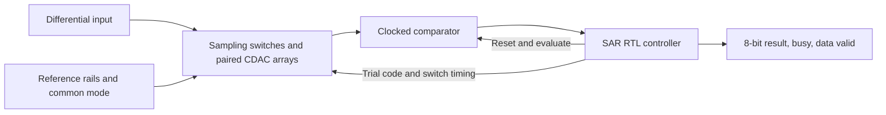

# 8-bit SAR ADC: phase-wise design and verification plan

## Objective and scope

Build a software-only, differential 8-bit successive-approximation ADC with synthesizable RTL control, a charge-redistribution capacitor DAC (CDAC), analog nonideality models, and selected transistor-level SPICE circuits. Produce evidence useful for both Texas Instruments Analog Engineer and Digital Engineer interviews.

This is a proposed project specification. All performance numbers below are targets or modelling assumptions, not measured achievements. No hardware, fabrication, tool installation, remote repository creation, or publication has been performed by writing this plan.

Planning estimate: **14 weeks at 10-12 hours/week**. Allow another 2-4 weeks if MOS circuits and RTL are new. The first working RTL-plus-behavioural-analog milestone should be available by week 6. Advance when a phase's gate passes; revise the schedule when it does not.

Use a future dedicated repository, suggested name `sar-adc-8bit`. The current workspace's parent Git remote belongs to Stock-Analysis; do not commit ADC implementation into that repository by accident.

The core deliverables are:

- An independent mathematical reference converter.
- Synthesizable RTL with an automated, self-checking verification environment.
- A circuit-based behavioural analog model connected to the actual RTL.
- SPICE sampling/CDAC benches and a transistor-level comparator with documented model coverage.
- A SPICE-characterized surrogate model for larger integrated sweeps.
- Static/dynamic characterization, sensitivity experiments, synthesis and constrained timing reports.
- A reproducible engineering report with target-versus-achieved results.

Full transistor-level ADC layout, silicon fabrication, an on-chip reference generator, SPI/APB interfaces, calibration, and FPGA hardware are optional extensions. Keep these outside the first release.

## 1. Proposed architecture and specifications

Choose a differential analog core to keep the input common-mode voltage controlled while studying the comparator. A Python model can work with a single normalized input initially, but the SPICE architecture must follow the differential sampling and CDAC equations.



| Item | Starting specification |
|---|---|
| Resolution | 8 bits; 256 output codes |
| Architecture | Synchronous SAR; conventional binary-weighted differential CDAC |
| Nominal supply | 1.8 V; confirm device/model operating limits in Phase 1 |
| Input common mode | 0.9 V nominal |
| Differential input | -0.5 V to +0.5 V; full-scale span is 1.0 V |
| Input pins | `vin_p = 0.9 + vin_diff/2`, `vin_n = 0.9 - vin_diff/2` |
| CDAC reference rails | `vref_p = 1.15 V`, `vref_n = 0.65 V`; initially ideal sources |
| Output representation | Offset binary: negative differential full scale maps to 0, zero maps to 128 |
| LSB | `1.0 V / 256 = 3.90625 mV` differential |
| Core clock | 3.2 MHz; 312.5 ns period |
| Target initiation interval | 32 clock periods; 100 kS/s sustained conversion rate |
| Digital interface | Synchronous start, ready/busy, result, one-cycle data-valid indication |
| Nominal static targets | Monotonic; no missing codes; maximum absolute DNL <= 0.75 LSB and endpoint INL <= 1 LSB |
| Nominal dynamic target | Uncorrected ENOB >= 7 at approximately 1 kHz and -0.5 dBFS input |
| Higher-frequency characterization | Approximately 20 kHz; report achieved performance without promising the same ENOB |
| Power/area | Measure or estimate with stated scope; set optimization goals after a baseline exists |

These are project targets, not TI hiring requirements. Apply the nominal analog targets to a named, frozen model configuration. Report corner and mismatch results separately; a nominal pass does not establish statistical yield or a product guarantee.

### Quantizer convention

Let `FS = 1.0 V` and `LSB = FS/256`:

`ideal_code = clip(floor((vin_diff + FS/2)/LSB), 0, 255)`

Transition `k` is at `-FS/2 + k*LSB`, for `k = 1..255`. Exact equality selects the upper code. Use the code-center reconstruction `-FS/2 + (code + 0.5)*LSB` when discussing quantization error. Using the lower edge as a reconstructed voltage would create a different error convention.

### CDAC sizing and charge conservation

Each side contains binary groups `128, 64, 32, 16, 8, 4, 2, 1` unit capacitors plus one dummy unit. Total capacitance is `256*Cu` per side. Start with `Cu = 20 fF` in the behavioural model, giving 5.12 pF per side; revise this when selecting a supported physical capacitor and its parasitics.

During acquisition, clamp each top plate to 0.9 V and connect its bottom plates to the corresponding input. Release the top-plate clamp before switching the bottom plates to the reference network. The dummy is sampled with the array; during conversion it connects to the low reference on the P array and high reference on the N array. Derive and verify the switch table before SPICE implementation.

For matched ideal arrays and trial code `D`, the weighted bottom-plate voltages are:

- `vbot_p = vref_n + (D/256)*(vref_p-vref_n)`.
- `vbot_n = vref_p - (D/256)*(vref_p-vref_n)`.
- `vdac_diff = vbot_p-vbot_n = -0.5 + D/256` volts.
- After sampling, `vtop_p = vcm - vin_p_sampled + vbot_p`; similarly for N.
- Therefore `vtop_p-vtop_n = vdac_diff-vin_diff_sampled`.

Define `cmp_keep = 1` when `vtop_n >= vtop_p`, so the current trial bit is retained when `vin_diff_sampled >= vdac_diff`. Check this polarity explicitly: the top-plate residual has the opposite sign to input-minus-DAC.

### Starting timing budget

| State/function | Clock periods per conversion | Action |
|---|---:|---|
| ACQUIRE | 6 | Track inputs and establish sampled charge |
| HOLD | 1 | Release the top-plate clamps; preserve the sample; prepare switch sequencing |
| SET, SETTLE, EVAL | 3 per bit x 8 = 24 | Apply trial, allow DAC settling, evaluate comparator, then retain/clear bit |
| DONE | 1 | Publish the completed result and pulse data valid |
| Total service frame | 32 | Supports a target 10 us initiation interval with no extra idle bubble |

With SET and SETTLE each lasting one period, the DAC gets approximately 625 ns from a trial update to comparator evaluation. EVAL provides approximately 312.5 ns before the comparator result is captured. Subtract switch dead time, comparator interface delay, and digital setup margin from these budgets.

Specify accepted-start and result-valid edges with a waveform. State durations alone do not prove latency or throughput. Permit a new request at the frame boundary without an additional idle cycle; test the achieved initiation interval directly. The sample timestamp is the release of the top-plate clamps, not the DONE edge.

## 2. Tools and simulation fidelity

| Purpose | Proposed tool | Required evidence |
|---|---|---|
| Reference model and analysis | Python, NumPy, SciPy, Matplotlib, pytest | Independent quantizer tests and saved numerical results |
| RTL simulation | Icarus Verilog plus cocotb; Verilator as an optional second simulator | Passing tests, version record, waveforms |
| Analog circuits | ngspice; Xschem is optional for schematic capture | Reproducible netlists, raw measurements, convergence settings |
| Device models | SKY130-compatible models or a permitted university PDK | PDK revision and supported voltage/temperature/corner ranges |
| RTL synthesis | Yosys | Latch checks, mapped cell counts and area where a Liberty library is supplied |
| Timing | OpenSTA or an equivalent supported tool | Clock and I/O constraints, library corner, setup/hold reports, unconstrained-path review |
| Waveform inspection | GTKWave or Surfer | Annotated acquisition, bit-trial and completion traces |
| Optional true mixed-signal integration | ngspice XSPICE `d_cosim` with Verilator | A working feedback loop using the actual RTL and SPICE analog circuit |

For a Windows host, first check whether the needed tools already exist. WSL2/Linux is a practical candidate for a consistent open-source flow, but verify availability and simulator compatibility before choosing it. Record exact tested versions rather than assuming every current release works together.

Use three clearly named fidelity levels:

1. **Behavioural RTL-in-the-loop:** cocotb runs the actual RTL; Python maintains analog states and returns comparator decisions. This is the mandatory fast integration path.
2. **SPICE-characterized RTL-in-the-loop:** extract settling, comparator delay/offset and other supported properties from SPICE; use a validated surrogate in the same RTL testbench. This is required for the full core release.
3. **Direct SPICE/RTL co-simulation:** actual SPICE analog nodes feed the actual RTL and vice versa. This is a recommended extension after a small toolchain smoke test. Exporting RTL switch waveforms and replaying them into SPICE is useful open-loop validation, but does not establish a closed-loop co-simulation result.

SKY130 provides SPICE models compatible with ngspice [R3]. ngspice documents Verilator-based `d_cosim` support from version 42, subject to the installed build and its dependencies [R2]. Select the cocotb/simulator pair against its current compatibility documentation [R1].

## 3. Phase schedule

| Phase | Week(s) | Deliverable | Gate before advancing |
|---|---|---|---|
| 0. Foundations and tool smoke tests | 1, first half | Working Python, RTL and SPICE examples | Each tool executes a tiny known-answer example |
| 1. Specifications and architecture | 1, second half | Frozen requirements, charge equations and timing contract | Hand calculations, polarity and frame timing reviewed |
| 2. Ideal reference converter | 2 | Independent quantizer, SAR model, baseline plots | Full ideal static tests and metric checks pass |
| 3. RTL controller and verification | 3-4 | Synthesizable SAR RTL and self-checking tests | Complete bit sequencing, protocol and reset tests pass |
| 4. Behavioural analog integration | 5-6 | Actual RTL connected to stateful analog model | Ideal equivalence and controlled nonideality experiments pass |
| 5. SPICE analog blocks | 7-9 | Sampling/CDAC benches and transistor-level comparator | Charge behaviour, settling and comparator timing characterized |
| 6. SPICE-derived integrated model | 10 | Validated surrogate used with actual RTL | Held-out SPICE comparisons and integrated regressions pass |
| 7. ADC characterization | 11-12 | Static/dynamic, corner and sensitivity report | Targets assessed with reproducible data and limitations |
| 8. Synthesis and timing | 13 | Mapped RTL implementation and timing reports | No unintended latches; timing constraints and reports reviewed |
| 9. Release and interview package | 14 | Reproducible repository, report and short demo | Fresh reproduction and claim/evidence audit complete |

## Phase 0. Foundations and tool smoke tests

Study binary search, capacitor charge conservation, differential/common-mode signals, sampling, quantization, MOS differential pairs, regenerative comparators, FSMs and nonblocking assignments. Learn enough to derive the next phase's equations yourself.

Execute a Python unit test, an RTL counter/FSM with one cocotb test, and an ngspice RC transient with a known time constant. Load one transistor model and inspect its operating point. Record tool and PDK versions. If considering direct co-simulation, try a tiny Verilog-controlled analog switch before committing to that route.

**Deliverables:** `docs/environment.md`, pinned Python dependencies and smoke-test logs. **Gate:** the examples produce expected numerical results; no unresolved simulator/PDK loading errors.

## Phase 1. Freeze requirements, architecture and timing

Create a requirement-to-test matrix for resolution, conversion timing, result stability, reset, acquisition, static linearity, dynamic performance and model fidelity. Fix the quantizer, comparator tie rule, sampling aperture and switch sequence described above.

Hand-trace conversion of at least five inputs, including a negative input, zero, a positive input, and values around a transition. Check the differential CDAC equations at codes 0, 127, 128 and 255. Show how the dummy capacitor makes the denominator 256.

Define ports such as `clk`, `rst_n`, `start`, `ready`, `busy`, `cmp_keep`, `trial_code[7:0]`, sampling/reference selection, comparator evaluate/reset, `data[7:0]`, and `data_valid`. Use a single digital clock with enables. Define start-while-busy policy as ignored, reset as conversion abort with no stale valid pulse, and data as stable until the next valid result. Reset release must follow a documented synchronous timing contract.

Define the comparator result's valid window and the receiving register's setup margin. A late or unresolved decision is a detected timing failure in simulation. A two-flop synchronizer cannot be inserted without reworking the SAR timing contract.

**Deliverables:** `docs/requirements.md`, `docs/architecture.md`, `docs/timing.md`, `config/spec.yaml`. **Gate:** no ambiguity about polarity, reference scaling, final LSB capture or sustained initiation interval.

## Phase 2. Ideal Python reference converter

Implement two independent paths: a direct analytical quantizer and a step-by-step binary-search SAR. The first must not call the second. Save each conversion's trial codes, comparator decisions and final code.

Test all 256 code centers, both sides of all 255 transitions, full-scale boundaries, clipping, a dense ramp and at least 10,000 seeded random values. Keep exact-tie tests separate from floating-point roundoff; use rational arithmetic or a documented tolerance where needed. Verify the centroid-based quantization-error bound for in-range signals.

Create ideal transfer, quantization-error and FFT plots. Validate the analysis functions with known synthetic signals, including a deliberately added harmonic and a known missing-code example, so a faulty metric script cannot approve a faulty ADC.

**Deliverables:** `model/ideal_adc.py`, `model/sar_reference.py`, `analysis/metrics.py`, tests and baseline data. **Gate:** both models agree for every deterministic test and the analysis recovers known injected defects.

## Phase 3. RTL controller and digital verification

Implement separate conversion working state, trial code and completed output registers. Use ACQUIRE/HOLD/SET/SETTLE/EVAL/DONE sequencing. Hold each trial steady throughout settling and evaluation. Latch the comparator after its evaluation interval. Ensure the final LSB decision reaches `data` rather than publishing the previous working register value.

First use an ideal comparator adapter. Compare the completed result against the analytical quantizer and the bit trace against the independently implemented SAR reference. Add checks for:

- Every output code and every bit's retain/clear outcomes.
- All 256 possible eight-decision sequences in a digital-only controller test.
- Reset in every state, including the final evaluation and DONE boundary.
- Start while busy, isolated conversions and continuous requests.
- Correct data-valid pulse width, stable output, exact sample count and no extra idle bubble.
- DAC stability during evaluation and no simultaneous acquisition/compare operation.
- Late comparator decisions detected by the timing monitor.

Use procedural cocotb monitors where the selected simulator does not support a particular assertion construct. Track functional coverage of FSM states, transitions and bit outcomes; do not treat an unexplained coverage percentage as the only pass criterion.

**Deliverables:** `rtl/sar_controller.sv`, `tb/test_sar_controller.py`, coverage summary and annotated waveform. **Gate:** all protocol and ideal-code tests pass with no unintended latches or unexplained unknowns in observable outputs.

## Phase 4. Behavioural analog integration

Replace the ideal DAC/comparator adapter with a stateful model that is driven by the actual RTL's switch commands. During conversion, hold the sampled input; do not compare every bit against a newly sampled live sine value.

Add imperfections one at a time, then combine a frozen nominal set:

| Effect | Required model behaviour |
|---|---|
| Acquisition | Track the input through finite source/switch resistance and capacitance |
| DAC settling | Move toward the capacitor-weighted target over physical time |
| Capacitor mismatch | Keep each physical unit's error fixed for an entire simulated instance |
| Comparator offset | Apply a fixed input-referred offset per configured instance |
| Comparator noise | Draw once per evaluation; do not redraw on every simulator polling operation |
| Sampling noise | Draw once at the sampling aperture using a stated equivalent model |
| Hold leakage | Evolve the held charge over conversion time |
| Reference impedance | Maintain a causal reference state affected by switching demand |
| Decision delay | Respect evaluation and receiving-register timing; flag unresolved decisions |

For example, `t_settle >= tau*ln(V_step/E_allowed)`. With a conservative 1 V differential step and an allowed 0.1 LSB residual, the first-order estimate is approximately `7.85*tau`. Validate more complex SPICE circuits against their own responses; this estimate is not a replacement for them. TI discusses acquisition settling and the dependence on the input network and ADC timing [R4].

Start with exploratory allocations of 0.1 LSB for acquisition residual, 0.1 LSB for CDAC settling, 0.25 LSB for comparator offset and 0.15 LSB RMS for comparator noise. These are separate design allocations, not a guaranteed additive accuracy bound. Treat systematic errors and random noise differently.

At 300 K, two independent 5.12 pF sampling arrays have a simplified differential sampling-noise estimate of `sqrt(2*k*T/C)`, approximately 40 uV RMS. Clearly state the assumptions; do not inject the same physical noise twice through both SPICE-derived data and a Python noise term.

**Deliverables:** `model/analog_frontend.py`, named YAML configurations, integrated tests and isolated-effect plots. **Gate:** all imperfections disabled reproduces the ideal RTL result; each enabled effect causes an explainable change.

**Week-6 milestone:** a complete, tested RTL-plus-behavioural ADC. It is already a digital project, but transistor-level analog claims remain pending.

## Phase 5. SPICE sampling network, CDAC and comparator

### Week 7: sampling and charge redistribution

Build sampling and paired binary CDAC netlists, beginning with ideal switches and capacitors. Check stored charge, dummy connectivity, reference polarity and common-mode movement. Then introduce supported switch/device models, on-resistance, leakage and explicit parasitics. Use break-before-make switching so input/reference sources are not accidentally shorted.

Measure acquisition error after worst-case input steps, settling for representative SAR code changes, hold droop and reference-current transients. Demonstrate timestep and tolerance convergence. Do not count a numerical stabilizing resistor as a physical leakage source without recording its effect.

### Weeks 8-9: transistor-level comparator

Design a clocked regenerative comparator, with a preamplifier if required by the measured offset, input range or kickback. Freeze one topology after a baseline; do not expand into a survey of many comparator architectures.

Characterize decision polarity, reset behaviour, delay versus differential overdrive, common-mode sensitivity, supply/corner sensitivity, input kickback and energy per evaluation. Include small overdrives around 0.1-0.5 LSB. Evaluate noise and mismatch only through a supported method; deterministic transient simulation alone does not measure random noise or statistical device mismatch.

Require supported input/common-mode operation and a decision before the allocated capture deadline for the declared minimum overdrive. Near exactly zero overdrive, characterize uncertainty and timeout behaviour rather than promising deterministic resolution. Update the specification transparently if the original budget is infeasible.

**Deliverables:** `analog/spice/`, transistor sizing rationale, automated characterization scripts, measured curves and raw data. **Gate:** charge equations match SPICE, settling fits the schedule, and the comparator's characterized operating envelope is documented.

## Phase 6. Integrate SPICE-derived analog behaviour

Fit or tabulate SPICE results into the fast analog model. Validate on held-out voltage, timing and overdrive points. Compare residual-voltage errors and decision delays numerically. An initial surrogate goal is residual prediction within 0.05 LSB and decision-delay prediction within 10% where the comparator is decisively resolved; refine it if a smaller error changes ADC conclusions.

Run the actual RTL with this model. Check that digital timing uses characterized analog delays and preserves the sample. Keep every configuration's fidelity level in saved results.

If the optional direct co-simulation toolchain works, run representative conversions, such as codes near the rails, 127/128 and selected transitions, with real SPICE feedback to real RTL. Compare traces with the surrogate. Use a small case set first; large FFT/Monte Carlo workloads belong in the validated fast path unless runtime permits more.

**Deliverables:** `model/spice_surrogate.py`, validation data, integrated traces and a model-coverage table. **Gate:** supported-domain predictions pass declared tolerances; extrapolated cases are identified and do not silently enter pass claims.

## Phase 7. Static, dynamic and sensitivity characterization

### Static measurements

Locate all 255 transition voltages for deterministic configurations, using a dense sweep followed by local refinement. Measure increasing and decreasing sweeps to expose memory effects. For noisy configurations, estimate transition probabilities using repeated conversions; distinguish their 50% locations from a single noisy ramp.

Calculate code widths, signed DNL, endpoint-corrected INL, offset, gain error, monotonicity and missing codes. Describe the endpoint/gain removal convention and finite sweep treatment of the two rail codes. Plot offset/gain errors separately; do not hide them through the INL correction. Definitions and transition-based measurement methods are discussed in [R5].

### Dynamic measurements

Use fixed-rate, uniformly timed conversions with one result per acquisition. Discard startup records. Use a 4096-point record and coherent tones `fin = k*fs/4096`, for example:

- `k = 41`: approximately 1000.98 Hz at 100 kS/s.
- `k = 821`: approximately 20043.95 Hz at 100 kS/s.

Both integers are coprime to 4096. Drive a -0.5 dBFS differential sine. Capture at the actual sample aperture. Define FFT normalization, DC handling, fundamental bins, aliased harmonic bins and the harmonic count before computing SNR, SINAD, THD and SFDR. For a coherent record, a rectangular window avoids unnecessary window corrections; use a documented windowing method when coherence is unavailable [R6].

Report `ENOB = (SINAD-1.76)/6.02`, the input amplitude and whether amplitude correction was applied. The proposed 7-bit target uses uncorrected ENOB; it corresponds to 43.9 dB SINAD. The approximately 49.92 dB ideal 8-bit full-scale sine value is a sanity check under its assumptions, not a required transistor-level result.

### Sensitivity and variation experiments

1. Sweep acquisition and settling intervals to find the accuracy/throughput boundary.
2. Sweep comparator offset, noise and delay separately.
3. Sweep reference impedance and capacitor parasitics.
4. Use approximately 200 seeded behavioural instances at each of a few declared unit-capacitor mismatch assumptions.
5. Characterize supported PDK corners, supply values and temperatures; run broader surrogate sweeps only where validated.
6. Combine the most influential effects after isolated sweeps identify them.

If a binary group contains `m` independent unit capacitors, sum those unit realizations; its relative random mismatch scales differently from applying the same fractional error to every binary group. Model spatial gradients/correlations separately. Assumed behavioural variation is sensitivity analysis and must not be presented as foundry-qualified yield.

**Deliverables:** `analysis/static.py`, `analysis/dynamic.py`, `analysis/sensitivity.py`, CSV/JSON results and figures. **Gate:** the report states which targets passed or failed for each configuration, with seeds, model versions and repeatable commands.

## Phase 8. Digital synthesis and constrained timing

Synthesize the controller into a named standard-cell library. Check latch inference, registers, combinational cells and mapped area. Yosys can report cell area when supplied with Liberty area data [R7]. Use an independent supported timing flow to analyze the mapped netlist [R8].

Constrain the 3.2 MHz clock and relevant I/O delays. Include external comparator availability/setup requirements rather than checking only register-to-register logic. Review unconstrained paths; do not use blanket false paths to conceal failures. Distinguish pre-layout timing estimates from routed timing with extracted parasitics.

Make one controlled architecture comparison, such as binary versus one-hot FSM encoding, using identical functional tests and timing constraints. Retain the better justified implementation. If estimating digital power, state the switching-activity source, cell models and excluded physical effects. Measure analog block/source energy separately; label total ADC power unavailable if references, clocking or other contributions remain unmodelled.

**Deliverables:** `synth/`, `constraints/`, netlist, area/timing reports and one trade-off table. **Gate:** no unintended latches, no unexplained unconstrained paths, and timing conclusions match the actual analysis scope.

## Phase 9. Release, demonstration and interview preparation

Reproduce the small regression from a fresh environment. Record tool versions, PDK revision, configuration hashes and random seeds. Keep large runs explicit rather than running them on every edit. Preserve failed experiments and explain useful design changes.

Prepare:

- A README with specifications, block diagram, fidelity levels and reproduction commands.
- A target-versus-achieved results table linked to raw measurements.
- Transfer/DNL/INL plots, low/high-frequency FFTs, settling and comparator-delay plots.
- An annotated timing trace showing one complete conversion and the final LSB decision.
- A short engineering report and a 2-3 minute demonstration.
- A requirement-to-test matrix and a model limitations table.

Practice explaining why SAR was selected, why the CDAC needs its dummy, how differential reference scaling works, why acquisition and conversion time differ, how mismatch changes DNL, how comparator delay affects timing, and how RTL avoids the final-bit publishing bug.

Only include measured, appropriately scoped claims on a resume. A completed project might support a statement such as: "Designed and verified an 8-bit SAR controller with a differential charge-redistribution ADC model; characterized [measured metrics] using [named fidelity level]." Fill the brackets after execution.

**Gate:** the published claim/evidence table is complete. Publish or share externally only when requested during implementation; this planning request does not itself require a remote release.

## 4. Suggested repository structure

```text
sar-adc-8bit/
  README.md
  config/              # Frozen specs, named models, experiment settings
  docs/                # Architecture, timing, calculations, verification plan
  model/               # Ideal, behavioural and SPICE-derived models
  rtl/                 # Synthesizable controller and control interfaces
  tb/                  # cocotb tests, analog adapter, protocol monitors
  analog/spice/        # CDAC, sampler, comparator and characterization benches
  analysis/            # Static/dynamic metrics and experiment processing
  tests/               # Reference-model and analysis tests
  synth/               # Synthesis scripts and report generation
  constraints/         # SDC and interface timing assumptions
  results/             # Small reproducible data, manifests and summaries
  report/              # Final report and selected figures
```

At execution time, provide simple commands for environment checks, ideal tests, RTL regression, analog characterization, characterization summaries and report generation. Avoid claiming a command exists until its script has actually been implemented.

## 5. Scope control and optional extensions

- If analog tools become difficult, preserve the working behavioural RTL milestone while resolving SPICE setup.
- If the comparator misses timing, increase evaluation time and report the resulting lower throughput. Do not retain the 100 kS/s claim without meeting its schedule.
- If model mismatch data is unavailable, report assumed behavioural sensitivity instead of inventing PDK statistics.
- If the surrogate does not match SPICE, narrow its valid range or improve it before using it for broad conclusions.
- Keep an on-chip reference generator, digital calibration and external bus interfaces outside the core project.

After the core release, choose one extension: direct SPICE/RTL co-simulation, comparator/CDAC layout with DRC/LVS and extracted simulation, or a calibrated/nonbinary SAR architecture. A small verified layout block is more manageable than immediate full-chip implementation. Expect approximately 3-6 additional weeks for a first analog-layout extension.

## References

- **R1:** [cocotb simulator support](https://docs.cocotb.org/en/stable/simulator_support.html).
- **R2:** [ngspice mixed-signal and behavioural simulation features](https://ngspice.sourceforge.io/extras.html).
- **R3:** [SKY130 simulation documentation](https://skywater-pdk.readthedocs.io/en/main/sim.html).
- **R4:** [TI SBAA531: sample-and-hold and settling model](https://www.ti.com/document-viewer/lit/html/SBAA531/GUID-C628EB31-82F2-49EE-9BCE-BC451204DC7F).
- **R5:** [Analog Devices: INL/DNL measurement methods](https://www.analog.com/en/resources/technical-articles/inldnl-measurements-for-types-of-highspeed-adcs.html).
- **R6:** [Analog Devices: coherent sampling versus window sampling](https://www.analog.com/en/resources/technical-articles/coherent-sampling-vs-window-sampling.html).
- **R7:** [Yosys statistics and Liberty cell-area reporting](https://yosyshq.readthedocs.io/projects/yosys/en/v0.49/cmd/stat.html).
- **R8:** [OpenSTA documentation](https://opensta.readthedocs.io/en/latest/).

Reference capabilities checked on 17 October 2026. Pin the versions actually used during implementation.
