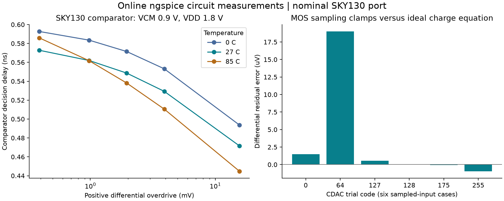
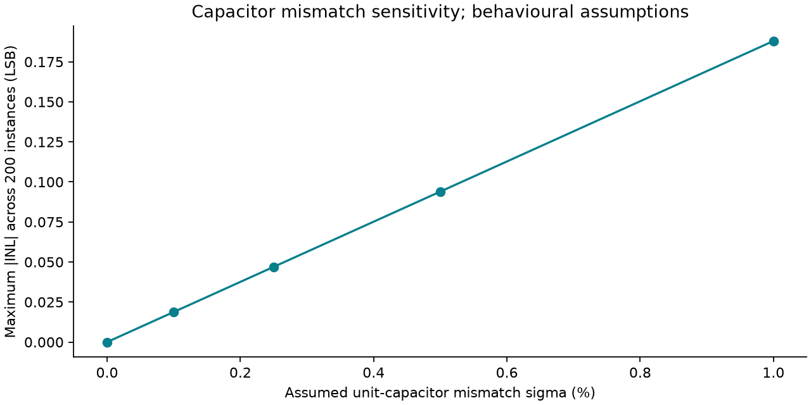

# Engineering report: 8-bit differential SAR ADC

## Objective

Design and verify a differential SAR conversion system, relate RTL timing to selected analog circuits, and quantify the effects of modelling assumptions. The project is entirely virtual.

## Specifications and measured results

| Metric | Target | Measured simulation result |
|---|---|---|
| Resolution | 8 bits | All 256 codes observed |
| Sustained sample interval | 32 clocks | 32 clocks at 3.2 MHz: 100 kS/s |
| Max absolute DNL | <= 0.75 LSB | 0.04052 LSB |
| Max absolute endpoint INL | <= 1 LSB | 0.03794 LSB |
| Uncorrected ENOB, 1000.98 Hz | >= 7 | 7.890 bits |
| SINAD, low-frequency record | Report | 49.258 dB |
| Uncorrected ENOB, 20043.95 Hz | Report | 7.896 bits |

The nominal configuration is in [spice-characterized.json](../config/spice-characterized.json). Full numeric static/dynamic data is in [characterization.json](../results/characterization.json). Dynamic CSVs contain one actual RTL output per sample; no reconstructed ideal outputs are substituted for the measured codes.

## Architecture and verification

The analytical quantizer, charge-based reference, synthesizable controller and analog-state model are separate implementations. The full RTL gate checked 11,021 input conversions, all 256 comparator-decision sequences, all bit retain/clear outcomes, reset/recovery in every active state, and a 32-clock continuous initiation interval. The one-hot controller has an additional 768-conversion and reset regression.

The comparator keeps a trial when top N is at least top P. The final LSB decision updates the completed output register on the same edge. A stored analog input is used throughout conversion, and comparator noise is drawn once per evaluation. Unit-capacitor mismatch remains fixed throughout each simulated device instance.

## Online analog evidence

The online runner used ngspice with the pinned EEcircuit SKY130 model port. Forty-two comparator operating points cover both input polarities, overdrives from 0.1 to 4 LSB, selected input common modes, supplies and temperatures. The largest measured decision delay was 1.513 ns. A 10 ps versus 20 ps timestep comparison changed delay by at most 0.1521%. Ideal CDAC charge residuals matched the derived equation within 50 nV for six cases. Additional MOS sampling-clamp results are retained when available.

The corrected SKY130 transmission-gate sampling-clamp bench matched the differential charge result within 19 uV (0.0049 LSB) across its six cases. An initial gate/source wiring error and its failed measurements are retained in the experiment log.

The lumped 5.12 pF acquisition and driver benches identified 51.2 ns and 25.6 ns time constants. This validates a reduced-order RC approximation, not all settling mechanisms of an assembled ADC. Held-out comparator delay predictions had at most 1.2013% relative error. Calibration does not establish random noise, process variation or layout behaviour.

## Model coverage

| Element/effect | Evidence level |
|---|---|
| SAR controller | Actual RTL simulation and mapped digital implementation |
| Ideal CDAC charge conservation | Online SPICE capacitor/switch benches |
| SKY130 comparator | Online transistor-level nominal-port simulations and voltage/temperature checks |
| Acquisition/DAC-driver settling | Online lumped RC characterization |
| Comparator delay in full-system runs | SPICE-derived reduced-order interpolation |
| Capacitor mismatch, noise, offset, leakage, reference network | Explicit behavioural assumptions and sensitivity experiments |
| Process-corner yield, full ADC layout, silicon | Not established |

## Static and dynamic analysis conventions

Static transition measurements disable random noise and condition repeated conversions before each decision. Endpoint INL fits transitions 1 and 255. DNL uses the 254 interior widths; clipped rail-code widths are excluded. Offset and gain error are reported separately.

Dynamic analysis uses 4,096 uniformly timed samples after startup, a -0.5 dBFS sine, and coherent bins 41 and 821 at 100 kS/s. DC is removed. SNR excludes harmonics 2-5, SINAD includes all non-fundamental non-DC power, and harmonic bins are folded into Nyquist. The reported ENOB is uncorrected for input amplitude; an amplitude-corrected number is also retained in the raw JSON.

## Sensitivity experiments

Five assumed unit-capacitor mismatch levels each use 200 fixed seeded instances. Binary groups are sums of physical unit draws. These are sensitivity results, not foundry-qualified yield estimates. Isolated sweeps additionally show the effects of offset, acquisition time, DAC settling and hold leakage. Failed accuracy cases remain in the data.

## Digital implementation

| FSM encoding | Mapped cells | Cell area (um^2) | Setup/hold worst-slack values (ns) |
|---|---:|---:|---|
| binary | 127 | 1277.475 | 155.608, 0.348 |
| one-hot | 138 | 1355.050 | 155.608, 0.280 |

Compare both explicit encodings under the same library and constraints. This includes the external state-debug decoding. Pre-layout area/timing does not include clock distribution, pad loading beyond the declared constraints, physical parasitics or analog layout.

## Reproduction and claim boundaries

See the [README](../README.md) for commands, [phase results](../docs/PHASE_RESULTS.md) for gates and [online provenance](../results/online-provenance.json) for cloud execution. Earlier failed workflow attempts are retained. Selected analog measurements and full-system model results are reported separately.

The current project supports an interview discussion of SAR sequencing, charge redistribution, verification strategy, comparator timing, ADC metrics and digital implementation trade-offs. A full transistor-level ADC feedback loop, full-chip physical design, on-chip references and fabrication are extensions.
